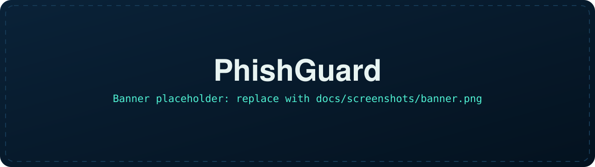
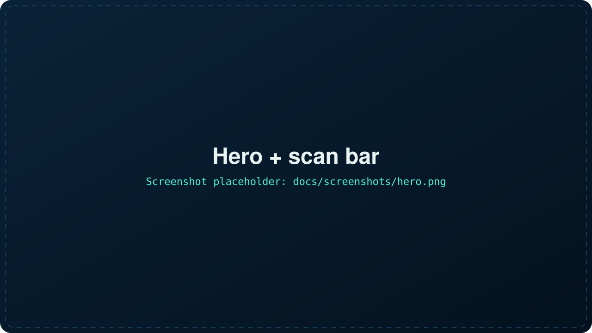
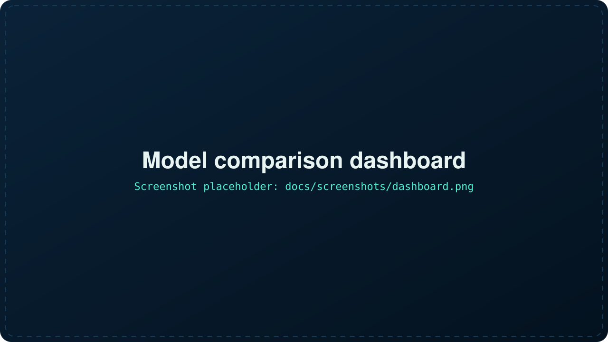
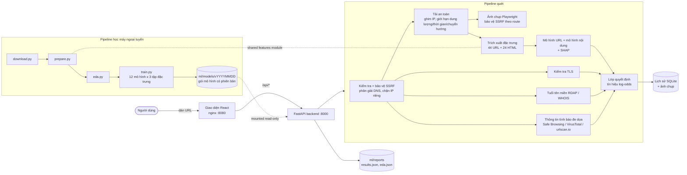
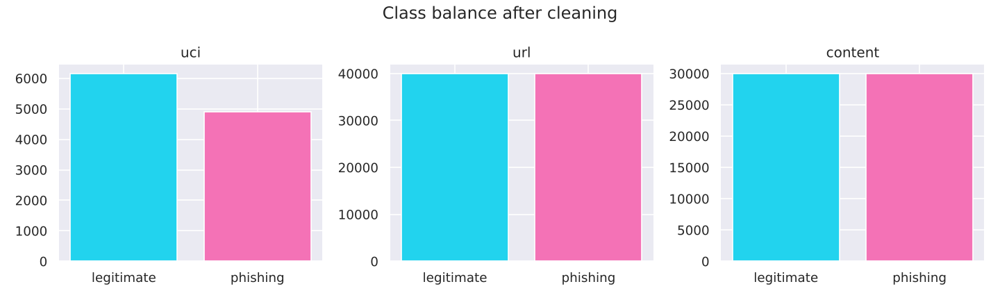
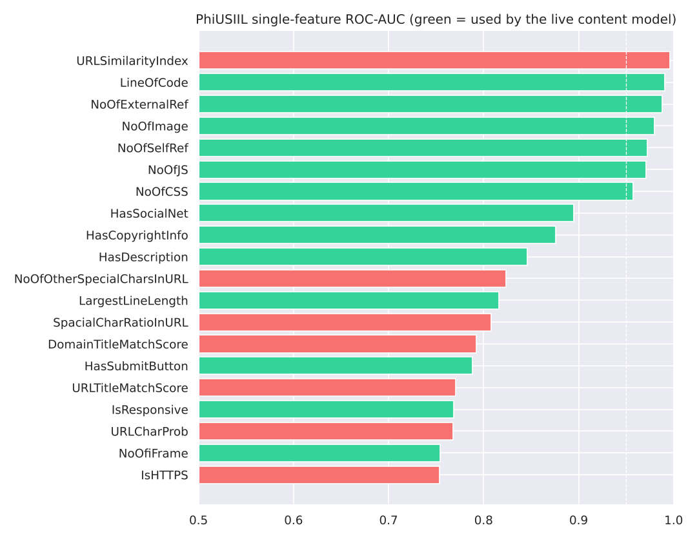
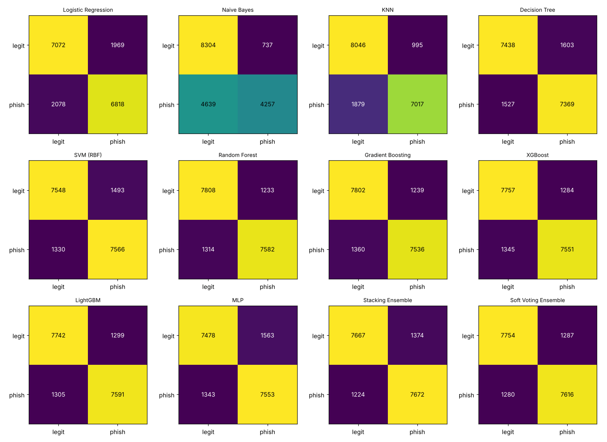

<p align="center">
  
</p>

<h1 align="center">PhishGuard</h1>
<p align="center"><b>Khung học máy so sánh để phát hiện an toàn các trang web giả mạo</b></p>
<p align="center">
  
  
  
  
  
</p>

> Dán bất kỳ liên kết nào. PhishGuard mở liên kết trong trình duyệt được cô lập, trích xuất 68 đặc trưng từ địa chỉ
> và trang, chạy mô hình tốt nhất trong 12 mô hình đã so sánh, kết hợp bằng chứng trực tiếp (tuổi tên miền, TLS,
> chuyển hướng, uy tín và thông tin tình báo đe dọa), sau đó trả về **Legitimate / Suspicious / Phishing** cùng xác
> suất, ảnh chụp màn hình và lý do.

| Màn hình chính + thanh quét | Kết luận trực tiếp | Bảng điều khiển mô hình |
|---|---|---|
|  |  |  |


> **Ảnh chụp màn hình này chỉ là nơi giữ chỗ.** Thay các tệp SVG trong `docs/screenshots/` bằng ảnh chụp thật
> (`hero.png`, `scanner.png`, `dashboard.png`, `demo.gif`) rồi cập nhật các liên kết ở trên.

---

## Mục lục
1. [Tóm tắt](#tom-tat)
2. [Tính năng](#tinh-nang)
3. [Kiến trúc](#kien-truc)
4. [Ngăn xếp công nghệ](#ngan-xep-cong-nghe)
5. [Bộ dữ liệu](#bo-du-lieu)
6. [Phương pháp](#phuong-phap)
7. [Kết quả](#ket-qua)
8. [Tính mạnh mẽ, rò rỉ dữ liệu và khả năng giải thích](#tinh-manh-me-ro-ri-du-lieu-va-kha-nang-giai-thich)
9. [Khởi chạy nhanh (Docker)](#khoi-chay-nhanh-docker)
10. [Chạy trực tiếp không dùng Docker](#chay-truc-tiep-khong-dung-docker)
11. [Huấn luyện lại mô hình](#huan-luyen-lai-mo-hinh)
12. [API](#api)
13. [Biến môi trường](#bien-moi-truong)
14. [Triển khai Cloudflare Pages và Render](#trien-khai-cloudflare-pages-va-render)
15. [Mô hình bảo mật](#mo-hinh-bao-mat)
16. [Cấu trúc dự án](#cau-truc-du-an)
17. [Đẩy lên GitHub](#day-len-github)
18. [Hạn chế và đạo đức](#han-che-va-dao-duc)
19. [Hướng phát triển](#huong-phat-trien)
20. [Tài liệu tham khảo](#tai-lieu-tham-khao)
21. [Ghi công và giấy phép](#ghi-cong-va-giay-phep)

---

## Tóm tắt

Các công cụ phát hiện lừa đảo được công bố trên các bộ chuẩn công khai thường báo độ chính xác từ 97–100%, nhưng nhiều
công cụ không hoạt động tốt với các liên kết ngoài đời thực. Dự án này đặt câu hỏi vì sao và xây dựng một công cụ vẫn
đáng tin cậy khi vượt ra ngoài bộ chuẩn. Mười hai bộ phân loại (Hồi quy Logistic, Naive Bayes, KNN, Cây quyết định,
SVM, Rừng ngẫu nhiên, Gradient Boosting, XGBoost, LightGBM, MLP và các tập hợp stacking/soft-voting) được tinh chỉnh
bằng Optuna và so sánh trong cùng điều kiện trên ba tập đặc trưng: bộ chuẩn kinh điển **UCI Phishing Websites**, tập
**URL trực tiếp theo cú pháp** và tập **nội dung HTML trực tiếp** được xây dựng từ **PhiUSIIL** cùng một bộ dữ liệu
URL thứ hai.

Phân tích phát hiện các hiện tượng giả tạo mạnh trong bộ dữ liệu: mọi URL hợp pháp trong PhiUSIIL đều là trang chủ
`https://www.<domain>` không có đường dẫn; một cột của PhiUSIIL (`URLSimilarityIndex`) gần như phân tách hoàn toàn
các lớp; và 47% dòng trong UCI là bản sao chính xác. Việc loại bỏ các lối tắt này (chuẩn hóa URL, bổ sung liên kết
hợp pháp sâu hơn từ nguồn thứ hai, chỉ dùng đặc trưng có thể tái tạo và chia tập huấn luyện/thử nghiệm theo **nhóm
website**) làm giảm các con số nổi bật nhưng tạo ra mô hình có khả năng tổng quát hóa tới tên miền chưa từng gặp.
Các mô hình tốt nhất được triển khai qua bộ quét FastAPI được gia cố, truy cập URL an toàn, giải thích dự đoán bằng
SHAP và kết hợp bằng chứng trực tiếp trong một lớp quyết định minh bạch.

## Tính năng

- **So sánh 12 mô hình** với cùng phép chia dữ liệu, tinh chỉnh Optuna, kiểm định chéo 5-fold và Accuracy / Precision /
  Recall / F1 / ROC-AUC / PR-AUC / ma trận nhầm lẫn / thời gian huấn luyện và suy luận cho từng mô hình (JSON + CSV).
- **Học máy có kiểm soát rò rỉ dữ liệu**: chuẩn hóa URL, chia theo nhóm website, phân tích bản sao, kiểm định AUC
  từng đặc trưng, kiểm tra chéo tập dữ liệu, ablation, hiệu chỉnh (Brier score) và bộ kiểm tra hợp lý với dữ liệu thực.
- **Tương thích huấn luyện–triển khai**: một mô-đun trích xuất đặc trưng (`backend/app/features/`) được huấn luyện
  và bộ quét trực tiếp cùng sử dụng; gói mô hình ghi phiên bản lược đồ đặc trưng và băm danh sách từ khóa.
- **Bộ quét trực tiếp** (`POST /api/scan`): tải dữ liệu có chống SSRF, ghim DNS và kiểm tra từng chuyển hướng,
  chụp màn hình bằng Playwright trong container cô lập, kiểm tra chứng chỉ TLS, tuổi tên miền RDAP/WHOIS,
  robots.txt, chuỗi chuyển hướng, Google Safe Browsing, VirusTotal và urlscan.io (tùy chọn), giải thích SHAP,
  bộ nhớ đệm, giới hạn tốc độ và lịch sử SQLite.
- **Giao diện điện ảnh**: React + Vite + TypeScript, Tailwind, GSAP ScrollTrigger, Framer Motion, Lenis, Three.js
  cùng quả địa cầu âm thanh; linh vật SVG hoạt hình gốc (Lumen – người bảo vệ và Angler) phản ứng theo từng kết luận;
  con trỏ tùy chỉnh, nút từ tính, trình bày cuộn ghim, băng chuyền ngang, chữ chạy, chuyển trang, hoạt ảnh mở đầu,
  chủ đề sáng/tối, trang 404 và hỗ trợ `prefers-reduced-motion`.
- **Docker**: bản dựng đa giai đoạn, image không chạy bằng root, Chromium được tích hợp trong image backend,
  healthcheck, hệ thống tệp gốc chỉ đọc, loại bỏ capabilities, volume cho mô hình/báo cáo/lịch sử và stack dev hot reload.

## Kiến trúc



## Ngăn xếp công nghệ

| Tầng | Công nghệ |
|---|---|
| ML | scikit-learn 1.5, XGBoost 2.1, LightGBM 4.5, Optuna 4.1, SHAP 0.48, pandas, matplotlib/seaborn |
| Backend | FastAPI, Uvicorn, httpx, BeautifulSoup + lxml, tldextract, cryptography, python-whois/RDAP, Playwright (Chromium), SQLite |
| Frontend | React 18, Vite 5, TypeScript, Tailwind CSS 3, GSAP + ScrollTrigger, Framer Motion, Lenis, Three.js + React Three Fiber |
| Vận hành | Docker đa giai đoạn, nginx-unprivileged, docker compose (prod + dev), hadolint |

## Bộ dữ liệu

| Bộ dữ liệu | Số dòng | Sử dụng cho | Nguồn (bản sao dự phòng) |
|---|---|---|---|
| UCI Phishing Websites (Mohammad, Thabtah & McCluskey) | 11.055 x 30 | Chỉ làm bộ chuẩn so sánh | [UCI #327](https://archive.ics.uci.edu/dataset/327/phishing+websites) ([bản sao](https://github.com/Arkit003/NetworkSecurity)) |
| PhiUSIIL Phishing URL Dataset (Prasad & Chandra) | 235.795 x 54 | URL cho mô hình URL trực tiếp; cột HTML cho mô hình nội dung | [UCI #967](https://archive.ics.uci.edu/dataset/967/phiusiil+phishing+url+dataset) ([bản sao](https://github.com/elaaatif/DATA-MINING-PhiUSIIL-Phishing-URL)) |
| Bộ URL độc hại (faizann24) | 420.464 URL | Liên kết sâu hợp pháp + trang lừa đảo trên host bị xâm nhập | [GitHub](https://github.com/faizann24/Using-machine-learning-to-detect-malicious-URLs) |

`python ml/data/download.py` tải cả ba bộ dữ liệu, dùng bản sao dự phòng khi UCI không truy cập được, xác minh tệp bản
sao bằng SHA-256 và ghi `ml/data/raw/manifest.json`. Dữ liệu thô **không** được đưa vào git.

**Vì sao cần thêm mô hình?** Một số đặc trưng UCI (`web_traffic`, `Page_Rank`, `Google_Index`, `Links_pointing_to_page`,
`Statistical_report`) phụ thuộc vào dịch vụ đã ngừng hoạt động (Alexa, PageRank) nên không thể tính lại cho URL mới;
vì vậy mô hình UCI chỉ được huấn luyện để so sánh. Các mô hình **trực tiếp** được huấn luyện trên đặc trưng có thể
tính được từ URL thực: 44 đặc trưng cú pháp được trích xuất lại từ các URL trong bộ dữ liệu bằng bộ trích xuất của
dự án, và 24 đặc trưng HTML PhiUSIIL được chúng tôi triển khai lại để áp dụng cho trang trực tiếp.

## Phương pháp

1. **Làm sạch.** Chuẩn hóa nhãn thành `1 = phishing`. Loại bản sao URL sau khi chuẩn hóa và loại các URL có nhãn
   xung đột. Cân bằng 50/50 cho từng nguồn URL để nguồn dữ liệu không thể dự đoán nhãn.
2. **Chuẩn hóa.** Chuyển chữ thường, bỏ giao thức, bỏ `www.`, bỏ fragment và dấu `/` cuối. Cách này loại bỏ hiện
   tượng “trang chủ hợp pháp dạng https://www” của PhiUSIIL và hiện tượng mọi ký tự đều viết thường. HTTPS được đánh
   giá trực tiếp từ chứng chỉ thực tế.
3. **Chỉ dùng đặc trưng có thể tái tạo.** Loại `URLSimilarityIndex`, `TLDLegitimateProb`, `URLCharProb`, điểm khớp
   tiêu đề và số lượng chuyển hướng không được tài liệu hóa (xem kiểm định rò rỉ bên dưới).
4. **Chia dữ liệu.** Tách 80/20 có phân tầng. Với bộ dữ liệu trực tiếp, phép chia được **gom theo tên miền đăng ký**
   (`StratifiedGroupKFold`) để cùng một website không xuất hiện ở cả tập huấn luyện và thử nghiệm. UCI dùng phép chia
   ngẫu nhiên có phân tầng như trong tài liệu cùng một biến thể đã loại trùng lặp.
5. **Tinh chỉnh.** Optuna TPE với kiểm định chéo 3-fold (theo nhóm) trên mẫu phân tầng và cùng ngân sách cho mọi mô
   hình; sau đó kiểm định chéo 5-fold mô hình đã tinh chỉnh trên tập huấn luyện. SVM và KNN được huấn luyện trên mẫu
   giới hạn do chi phí O(n²), được ghi trong `results.json`.
6. **Lựa chọn.** Mô hình triển khai được chọn bằng **F1 kiểm định chéo** (đồng thứ hạng theo ROC-AUC), **không**
   theo tập thử nghiệm. Tập thử nghiệm chỉ được dùng một lần để báo cáo.
7. **Giải thích.** SHAP (TreeExplainer cho mô hình cây, permutation explainer cho mô hình khác) trên dữ liệu giữ lại;
   đồng thời dùng độ quan trọng impurity/gain hoặc permutation.
8. **Quản lý phiên bản.** `ml/models/vYYYYMMDD-HHMMSS/{url,content,uci}_model.joblib` + `metadata.json` (phiên bản thư
   viện, SHA-256 của mọi tệp, phiên bản lược đồ đặc trưng, băm danh sách từ khóa) và `ml/models/latest.json`.

### Điểm nổi bật EDA

| Cân bằng lớp | Kiểm định rò rỉ (ROC-AUC một đặc trưng PhiUSIIL) |
|---|---|
|  |  |

Các biểu đồ khác trong [`ml/reports/figures/`](ml/reports/figures): heatmap tương quan (`corr_*.png`), phân phối đặc
trưng (`dist_*.png`), đường cong ROC/PR (`roc_pr_*.png`), ma trận nhầm lẫn (`confusion_*.png`), biểu đồ chỉ số
(`metrics_*.png`) và tóm tắt SHAP (`shap_beeswarm_*.png`). Notebook
[`ml/notebooks/01_eda_and_model_comparison.ipynb`](ml/notebooks/01_eda_and_model_comparison.ipynb) mô tả toàn bộ.

## Kết quả

<!-- RESULTS:START -->
Tất cả số liệu đều trên **tập thử nghiệm giữ lại** (20%), do `ml/train.py` tạo ra từ toàn bộ dữ liệu. Các dòng được
sắp xếp theo F1 trên tập thử nghiệm. Mô hình **được triển khai** được chọn bằng F1 kiểm định chéo 5-fold, do đó không
phải lúc nào nó cũng là dòng có F1 thử nghiệm cao nhất.
Phiên bản mô hình `v20261023-144910`

#### Mô hình URL trực tiếp - 62.063 dòng huấn luyện / 17.937 dòng thử nghiệm, 44 đặc trưng, chia phân tầng theo nhóm (tên miền đăng ký)

| Mô hình | F1 CV (5-fold) | Accuracy | Precision | Recall | F1 | ROC-AUC | PR-AUC | Huấn luyện (s) | Suy luận / 1k dòng |
|---|---|---|---|---|---|---|---|---|---|
| Random Forest | 0.8428 ± 0.011 | 0.8580 | 0.8601 | 0.8523 | 0.8562 | 0.9171 | 0.9265 | 7.1 | 14.40 ms |
| Soft Voting Ensemble | 0.8471 ± 0.013 | 0.8569 | 0.8554 | 0.8561 | 0.8558 | 0.9202 | 0.9255 | 14.1 | 44.78 ms |
| **Stacking Ensemble** (đang triển khai) | 0.8489 ± 0.012 | 0.8552 | 0.8481 | 0.8624 | 0.8552 | 0.9209 | 0.9265 | 65.8 | 52.36 ms |
| LightGBM | 0.8458 ± 0.013 | 0.8548 | 0.8539 | 0.8533 | 0.8536 | 0.9156 | 0.9182 | 3.1 | 25.20 ms |
| Gradient Boosting | 0.8425 ± 0.010 | 0.8551 | 0.8588 | 0.8471 | 0.8529 | 0.9194 | 0.9284 | 36.2 | 2.90 ms |
| XGBoost | 0.8440 ± 0.013 | 0.8534 | 0.8547 | 0.8488 | 0.8517 | 0.9166 | 0.9223 | 2.4 | 4.60 ms |
| SVM (RBF) | 0.8407 ± 0.027 | 0.8426 | 0.8352 | 0.8505 | 0.8428 | 0.9017 | 0.9022 | 53.9 | 425.85 ms |
| MLP | 0.8454 ± 0.003 | 0.8380 | 0.8285 | 0.8490 | 0.8387 | 0.9092 | 0.9188 | 32.4 | 4.30 ms |
| KNN | 0.8145 ± 0.016 | 0.8398 | 0.8758 | 0.7888 | 0.8300 | 0.9019 | 0.8969 | 0.1 | 1211.08 ms |
| Decision Tree | 0.8086 ± 0.016 | 0.8255 | 0.8213 | 0.8284 | 0.8248 | 0.8936 | 0.8897 | 0.8 | 176 µs |
| Logistic Regression | 0.7893 ± 0.018 | 0.7744 | 0.7759 | 0.7664 | 0.7711 | 0.8405 | 0.8492 | 1.8 | 3.23 ms |
| Naive Bayes | 0.5816 ± 0.038 | 0.7003 | 0.8524 | 0.4785 | 0.6130 | 0.7899 | 0.7758 | 0.2 | 1.99 ms |

#### Mô hình nội dung trang trực tiếp - 48.232 dòng huấn luyện / 11.768 dòng thử nghiệm, 24 đặc trưng, chia phân tầng theo nhóm (tên miền đăng ký)

| Mô hình | F1 CV (5-fold) | Accuracy | Precision | Recall | F1 | ROC-AUC | PR-AUC | Huấn luyện (s) | Suy luận / 1k dòng |
|---|---|---|---|---|---|---|---|---|---|
| Gradient Boosting | 0.9929 ± 0.004 | 0.9961 | 0.9967 | 0.9953 | 0.9960 | 0.9999 | 0.9999 | 15.2 | 2.03 ms |
| **XGBoost** (đang triển khai) | 0.9937 ± 0.004 | 0.9961 | 0.9972 | 0.9948 | 0.9960 | 0.9999 | 0.9999 | 1.1 | 3.44 ms |
| Stacking Ensemble | 0.9933 ± 0.004 | 0.9961 | 0.9979 | 0.9941 | 0.9960 | 0.9999 | 0.9999 | 33.4 | 36.33 ms |
| LightGBM | 0.9934 ± 0.004 | 0.9960 | 0.9976 | 0.9943 | 0.9959 | 0.9999 | 0.9999 | 2.5 | 21.59 ms |
| MLP | 0.9905 ± 0.006 | 0.9958 | 0.9951 | 0.9963 | 0.9957 | 0.9998 | 0.9998 | 30.8 | 3.82 ms |
| Soft Voting Ensemble | 0.9935 ± 0.004 | 0.9958 | 0.9974 | 0.9941 | 0.9957 | 0.9999 | 0.9999 | 6.1 | 28.81 ms |
| Random Forest | 0.9853 ± 0.010 | 0.9952 | 0.9977 | 0.9925 | 0.9951 | 0.9998 | 0.9998 | 3.0 | 7.27 ms |
| SVM (RBF) | 0.9917 ± 0.003 | 0.9947 | 0.9941 | 0.9951 | 0.9946 | 0.9998 | 0.9998 | 1.8 | 16.53 ms |
| Logistic Regression | 0.9915 ± 0.004 | 0.9939 | 0.9929 | 0.9946 | 0.9938 | 0.9997 | 0.9997 | 0.2 | 732 µs |
| KNN | 0.9879 ± 0.004 | 0.9919 | 0.9899 | 0.9936 | 0.9918 | 0.9993 | 0.9992 | 0.0 | 423.86 ms |
| Decision Tree | 0.9794 ± 0.010 | 0.9902 | 0.9911 | 0.9889 | 0.9900 | 0.9980 | 0.9972 | 0.1 | 113 µs |
| Naive Bayes | 0.9583 ± 0.009 | 0.9675 | 0.9930 | 0.9400 | 0.9658 | 0.9958 | 0.9952 | 0.0 | 648 µs |

#### Bộ chuẩn UCI (chỉ để so sánh) - 8.844 dòng huấn luyện / 2.211 dòng thử nghiệm, 30 đặc trưng, chia ngẫu nhiên có phân tầng

| Mô hình | F1 CV (5-fold) | Accuracy | Precision | Recall | F1 | ROC-AUC | PR-AUC | Huấn luyện (s) | Suy luận / 1k dòng |
|---|---|---|---|---|---|---|---|---|---|
| Soft Voting Ensemble | 0.9645 ± 0.002 | 0.9778 | 0.9794 | 0.9704 | 0.9749 | 0.9977 | 0.9973 | 2.6 | 68.19 ms |
| Stacking Ensemble | 0.9659 ± 0.003 | 0.9774 | 0.9814 | 0.9674 | 0.9743 | 0.9977 | 0.9974 | 13.9 | 92.03 ms |
| **Random Forest** (đang triển khai) | 0.9665 ± 0.002 | 0.9760 | 0.9803 | 0.9653 | 0.9728 | 0.9975 | 0.9971 | 0.8 | 34.84 ms |
| LightGBM | 0.9648 ± 0.002 | 0.9747 | 0.9773 | 0.9653 | 0.9712 | 0.9969 | 0.9967 | 1.0 | 20.59 ms |
| Gradient Boosting | 0.9630 ± 0.002 | 0.9747 | 0.9792 | 0.9633 | 0.9712 | 0.9970 | 0.9968 | 1.5 | 3.82 ms |
| XGBoost | 0.9635 ± 0.003 | 0.9742 | 0.9772 | 0.9643 | 0.9707 | 0.9967 | 0.9965 | 0.9 | 19.14 ms |
| KNN | 0.9560 ± 0.003 | 0.9720 | 0.9781 | 0.9582 | 0.9680 | 0.9941 | 0.9929 | 0.0 | 119.92 ms |
| MLP | 0.9566 ± 0.002 | 0.9710 | 0.9731 | 0.9612 | 0.9671 | 0.9955 | 0.9952 | 6.2 | 2.87 ms |
| SVM (RBF) | 0.9563 ± 0.004 | 0.9692 | 0.9691 | 0.9612 | 0.9652 | 0.9930 | 0.9915 | 6.1 | 150.82 ms |
| Decision Tree | 0.9262 ± 0.006 | 0.9421 | 0.9286 | 0.9418 | 0.9352 | 0.9869 | 0.9830 | 0.0 | 222 µs |
| Logistic Regression | 0.9177 ± 0.005 | 0.9276 | 0.9343 | 0.9000 | 0.9168 | 0.9785 | 0.9766 | 0.0 | 437 µs |
| Naive Bayes | 0.8445 ± 0.004 | 0.8417 | 0.7476 | 0.9704 | 0.8446 | 0.9677 | 0.9617 | 0.0 | 730 µs |

**Cách đọc các số liệu.** F1 ~86% / ROC-AUC 0,9209 của mô hình URL trực tiếp được đo trên **các website chưa từng xuất
hiện trong huấn luyện**; đây là số liệu đáng tin cậy cho một liên kết được dán vào. Điểm gần như hoàn hảo của mô hình
nội dung và F1 ~97% của UCI bị phóng đại do hiện tượng giả tạo trong bộ dữ liệu (xem bên dưới); đó là phát hiện chính
của phần so sánh.

| ROC / PR (URL trực tiếp) | Ma trận nhầm lẫn (URL trực tiếp) |
|---|---|
|  |  |

<!-- RESULTS:END -->

## Tính mạnh mẽ, rò rỉ dữ liệu và khả năng giải thích

<!-- ROBUSTNESS:START -->
| Tập dữ liệu | Kiểm tra | Kết quả | Ghi chú |
|---|---|---|---|
| Live URL | Chia ngẫu nhiên so với **chia theo website** | F1 87,9% so với **85,5%** | Các trang cùng website rò rỉ qua phép chia ngẫu nhiên làm điểm số tăng. |
| Live URL | Chéo bộ dữ liệu: huấn luyện phiusiil, thử nghiệm url_paths | ROC-AUC 0.4726 | Mô hình huấn luyện trên một nguồn URL không chuyển giao sang nguồn khác, vì vậy hai nguồn được kết hợp. |
| Live URL | Chéo bộ dữ liệu: huấn luyện url_paths, thử nghiệm phiusiil | ROC-AUC 0.8026 | Mô hình huấn luyện trên một nguồn URL không chuyển giao sang nguồn khác, vì vậy hai nguồn được kết hợp. |
| Live URL | Kiểm tra theo từng nguồn (phiusiil) | F1 87,6%, ROC-AUC 0.9163 | |
| Live URL | Kiểm tra theo từng nguồn (url_paths) | F1 83,6%, ROC-AUC 0.9253 | |
| Live URL | URL thực được chọn thủ công (24) | 96% chính xác | Chỉ mang tính minh họa, không dùng để huấn luyện hoặc lựa chọn. |
| Live content | Không dùng đặc trưng kích thước trang (LineOfCode, LargestLineLength, NoOfImage, ...) | F1 96,2% (so với 99,6%) | Số lượng kích thước chiếm phần lớn tín hiệu của PhiUSIIL. |
| Live content | Đặc trưng mạnh nhất | LineOfCode: ROC-AUC 0.9905 | Một cột gần như phân tách các lớp, đây là hiện tượng giả tạo trong dữ liệu. |
| UCI | Dòng thử nghiệm cũng xuất hiện trong tập huấn luyện | 1428 (65%) | 5.206 dòng trùng lặp chính xác trong bộ dữ liệu. |
| UCI | F1 chỉ trên dòng thử nghiệm chưa từng gặp / bộ chuẩn đã loại trùng lặp | 97,1% / 94,4% | Các bản sao làm phóng đại bộ chuẩn kinh điển. |
| Live URL | Hiệu chỉnh (Brier score, mô hình triển khai) | 0.1132 | Càng thấp càng tốt; 0,25 tương đương tung đồng xu. |
| Live content | Hiệu chỉnh (Brier score, mô hình triển khai) | 0.0031 | Càng thấp càng tốt; 0,25 tương đương tung đồng xu. |
| UCI | Hiệu chỉnh (Brier score, mô hình triển khai) | 0.0195 | Càng thấp càng tốt; 0,25 tương đương tung đồng xu. |

**Khả năng giải thích.** Các đặc trưng có ảnh hưởng lớn nhất (|SHAP| trung bình) của mô hình URL triển khai
(Stacking Ensemble) là `path_length`, `tld_length`, `max_path_segment_length`, `is_free_hosting`, `num_subdomains`,
`num_digits_host`; với mô hình nội dung (XGBoost) là `LineOfCode`, `NoOfSelfRef`, `NoOfExternalRef`, `NoOfImage`,
`HasSocialNet`, `NoOfJS`. API trực tiếp trả đóng góp SHAP cho từng lần quét và giao diện hiển thị chúng dưới dạng
thanh phân kỳ.

| SHAP - mô hình URL trực tiếp | SHAP - mô hình nội dung trực tiếp |
|---|---|
|  |  |

<!-- ROBUSTNESS:END -->

### Cách hình thành kết luận trực tiếp

```
p_ml   = 0.6 * p_url + 0.4 * p_content        (p_url chỉ dùng khi không thể tải trang)
logit  = log(p_ml / (1 - p_ml)) + tổng(các điều chỉnh tín hiệu)
p      = sigmoid(logit)  ->  < 0.40 Legitimate | 0.40-0.75 Suspicious | >= 0.75 Phishing
```

| Tín hiệu | Điều chỉnh (log-odds) |
|---|---|
| Tên miền đã đăng ký trên danh sách uy tín (không phải hosting miễn phí) | -2.5 |
| Tuổi tên miền < 30 ngày / < 180 ngày / >= 5 năm | +1.5 / +0.6 / -0.8 |
| Chứng chỉ không hợp lệ, hết hạn hoặc tự ký / HTTP thường / chứng chỉ hợp lệ | +1.0 / +0.5 / -0.2 |
| Chuyển hướng sang tên miền khác / meta-refresh | +0.5 / +0.3 |
| Biểu mẫu mật khẩu gửi sang tên miền khác / biểu mẫu mật khẩu có thương hiệu ngoài tên miền | +1.2 / +0.8 |
| VirusTotal >= 3 phát hiện / 1-2 / 0 (URL đã biết) | +3.0 / +1.2 / -0.3 |
| Google Safe Browsing có kết quả khớp | Buộc kết luận **Phishing** |

Mọi điều chỉnh được áp dụng đều được trả trong `signals[]` và hiển thị trên giao diện, do đó con số cuối cùng hoàn
toàn có thể kiểm tra. Danh sách uy tín (`backend/app/data/reputable_domains.txt.gz`, khoảng 132 nghìn tên miền) được
xây dựng bởi `ml/build_reputation.py` từ các tên miền hợp pháp của PhiUSIIL, bỏ các tên miền hosting miễn phí/rút gọn
liên kết và bỏ mọi tên miền xuất hiện dưới dạng lừa đảo trong bất kỳ bộ dữ liệu nào. Đây **không** phải là đặc trưng
của mô hình; dùng nó làm đặc trưng sẽ làm rò rỉ nhãn.

## Khởi chạy nhanh (Docker)

Yêu cầu: Docker Desktop (Windows/macOS) hoặc Docker Engine + Compose v2.24 trở lên.

```powershell
# Windows PowerShell
cd $HOME\Desktop\phishing-detector
docker compose up --build
```

Mở **http://localhost:8080**. Tài liệu API: **http://localhost:8080/api/docs**. Dừng bằng `Ctrl+C` hoặc chạy
`docker compose down` (thêm `-v` để đồng thời xóa lịch sử quét).

- Mô hình đã huấn luyện trong `ml/models/` và báo cáo trong `ml/reports/` được gắn ở chế độ chỉ đọc, vì vậy không cần
  huấn luyện để khởi chạy.
- Khóa API được đọc từ `backend/.env` (tùy chọn; xem [Biến môi trường](#bien-moi-truong)).
- Stack phát triển hot reload: `docker compose -f docker-compose.dev.yml up --build`, sau đó mở http://localhost:5173.
- Huấn luyện lại trong Docker: `docker compose --profile train run --rm trainer`, rồi `docker compose restart backend`.

## Chạy trực tiếp không dùng Docker

Yêu cầu: Python 3.12 hoặc 3.13, Node.js 20 trở lên.

```powershell
powershell -ExecutionPolicy Bypass -File scripts\setup.ps1     # venv, packages, Chromium, frontend deps, backend\.env
powershell -ExecutionPolicy Bypass -File scripts\run_dev.ps1   # backend :8000 + frontend :5173 trong hai cửa sổ
powershell -ExecutionPolicy Bypass -File scripts\test.ps1      # bộ test backend
```

macOS/Linux: `scripts/setup.sh`, `scripts/run_dev.sh`, `scripts/test.sh`.

## Huấn luyện lại mô hình

```powershell
powershell -ExecutionPolicy Bypass -File scripts\train.ps1          # chạy đầy đủ (khoảng 1-1,5 giờ trên CPU 2 lõi, nhanh hơn nhiều trên 8 lõi)
powershell -ExecutionPolicy Bypass -File scripts\train.ps1 -Fast    # chạy thử nghiệm ngắn (~20 phút)
powershell -ExecutionPolicy Bypass -File scripts\train.ps1 -Sets url  # chỉ một tập đặc trưng
```

Pipeline: `ml/data/download.py`, sau đó `ml/prepare.py`, `ml/eda.py`, `ml/build_reputation.py` và `ml/train.py`.
Mỗi lần chạy tạo thư mục phiên bản mới; backend tải thư mục mà `ml/models/latest.json` trỏ tới khi khởi động.
Các biến điều chỉnh ngân sách (env vars): `PG_FAST`, `PG_URL_SAMPLE`, `PG_CONTENT_SAMPLE`, `PG_TUNE_SAMPLE`, `PG_TRIALS`,
`PG_TUNE_TIMEOUT`, `PG_CV_MAX`, `PG_SVM_MAX`, `PG_KNN_MAX`, `PG_JOBS`. `python ml/report_table.py` in các bảng kết quả
được dùng trong README này.

## API

| Phương thức | Đường dẫn | Mô tả |
|---|---|---|
| `POST` | `/api/scan` | Quét URL. Body `{"url": "https://example.com", "use_cache": true}` |
| `GET` | `/api/models` | Toàn bộ kết quả so sánh (`ml/reports/results.json`) |
| `GET` | `/api/eda` | Tóm tắt EDA (`ml/reports/eda.json`) |
| `GET` | `/api/health` | Trạng thái, phiên bản mô hình đã tải, khả năng trình duyệt và thông tin tình báo |
| `GET` | `/api/history?limit=20` | Các lần quét gần nhất (SQLite) |
| `GET` | `/api/history/{id}` | Toàn bộ kết quả quét đã lưu |
| `GET` | `/api/intel/urlscan/{uuid}` | Kiểm tra kết quả urlscan.io đang chờ |
| `GET` | `/api/screenshots/{id}.jpg` | Ảnh chụp trong lần quét |
| `GET` | `/api/figures/{name}.png` | Hình báo cáo |

Tài liệu OpenAPI tương tác: `/api/docs`.

```bash
curl -s -X POST http://localhost:8080/api/scan -H "Content-Type: application/json" \
     -d '{"url":"https://github.com/login"}'
```

Phản hồi rút gọn (các giá trị chỉ mang tính minh họa):

```json
{
  "id": "e30e2a4e...", "url": "https://github.com/login", "final_url": "https://github.com/login",
  "verdict": "legitimate", "probability_phishing": 0.13, "risk_score": 13, "confidence": 0.87,
  "ml": {"p_url": 0.98, "p_content": 0.27, "blend": 0.69, "weights": {"url": 0.6, "content": 0.4}},
  "signals": [{"id": "reputation", "label": "Well-known domain", "impact": -2.5, "severity": "good", "source": "reputation"}],
  "explanations": {"url": [{"feature": "sensitive_word_count", "label": "Sensitive words (login, verify, account...)", "value": 1, "shap": 1.9}], "content": []},
  "redirect_chain": [{"url": "https://github.com/login", "status": 200, "ip": "140.82.114.4", "kind": "http"}],
  "tls": {"available": true, "verified": true, "issuer": "...", "days_remaining": 60},
  "whois": {"available": true, "age_days": 6600, "registrar": "MarkMonitor Inc."},
  "intel": {"google_safe_browsing": {"status": "ok", "flagged": false}, "virustotal": {"status": "ok", "malicious": 0, "engines": 94}, "urlscan": {"status": "pending", "uuid": "..."}},
  "screenshot_url": "/api/screenshots/e30e2a4e....jpg",
  "timings_ms": {"fetch": 421, "tls": 544, "whois": 435, "screenshot": 3300, "total": 5800}
}
```

Lỗi: `400 invalid_url` (giao thức sai, địa chỉ riêng/dự phòng, không phân giải được host), `429 rate_limited`
(mặc định 10 lần quét/phút cho mỗi client), `503 model_not_ready`.

## Biến môi trường

Sao chép `.env.example` thành **`backend/.env`**. Mỗi khóa đều tùy chọn; nếu thiếu, panel tương ứng hiển thị
*not configured*.

| Biến | Mặc định | Mục đích |
|---|---|---|
| `GOOGLE_SAFE_BROWSING_API_KEY` | - | Truy vấn Google Safe Browsing v4 |
| `VIRUSTOTAL_API_KEY` | - | Báo cáo URL VirusTotal v3 (gửi URL chưa biết) |
| `URLSCAN_API_KEY` | - | Gửi quét urlscan.io + lấy kết quả |
| `URLSCAN_VISIBILITY` | `unlisted` | `public`, `unlisted` hoặc `private` |
| `RATE_LIMIT_PER_MINUTE` | `10` | Số lượt quét trên mỗi IP client mỗi phút |
| `CACHE_TTL_S` | `900` | Tái sử dụng kết quả quét cho cùng URL |
| `SCREENSHOT_ENABLED` | `true` | Tắt ảnh chụp Playwright |
| `EXPLANATIONS_ENABLED` | `true` | Tắt phần giải thích dự đoán bằng SHAP |
| `TOTAL_SCAN_BUDGET_S` | `40` | Ngân sách thời gian cứng cho một lần quét |
| `MAX_RESPONSE_BYTES` | `3000000` | Giới hạn tải mỗi trang |
| `MAX_REDIRECTS` | `5` | Giới hạn số bước chuyển hướng |
| `MODELS_DIR` / `REPORTS_DIR` / `DATA_DIR` | đường dẫn repo | Tự động thiết lập trong Docker |
| `CORS_ORIGINS` | cổng dev localhost | Nguồn trình duyệt được phép |
| `TRUST_PROXY_HEADERS` | `false` | Tin `X-Real-IP` (bật phía sau nginx đi kèm) |

`backend/.env` nằm trong `.gitignore`, và các script đẩy mã từ chối commit mọi tệp `.env`.

## Triển khai Cloudflare Pages và Render

Frontend đang được phân phối tại [checkwebsite.pages.dev](https://checkwebsite.pages.dev). Cấu hình Blueprint
[`render.yaml`](./render.yaml) tạo backend Render Free mới tên `phishguard-checkwebsite-api`; không dùng chung
với các dịch vụ khác trong workspace.

1. Đẩy `render.yaml` và mã backend lên nhánh `main` của GitHub.
2. Trong Render, chọn **New > Blueprint**, kết nối repository `Liuyufang05/checkwebsite` ở nhánh `main`,
   kiểm tra cấu hình rồi chọn **Deploy Blueprint**.
3. Sau khi backend hoạt động, đặt `VITE_API_BASE` thành hostname `onrender.com` do Render cấp, dựng lại frontend
   và triển khai thư mục `frontend/dist` lên Pages:

   ```powershell
   $env:VITE_API_BASE = "https://<hostname-backend>.onrender.com"
   npm --prefix frontend run build
   npx wrangler pages deploy frontend/dist --project-name=checkwebsite --branch=main
   ```

Bản cấu hình miễn phí tắt ảnh chụp Chromium và giải thích SHAP để giảm mức dùng bộ nhớ. Dịch vụ có thể ngủ sau
15 phút không có yêu cầu, khởi động lại chậm và xóa lịch sử SQLite khi ngủ, khởi động lại hoặc triển khai lại;
không có ổ đĩa bền vững. Chỉ thêm khóa API tùy chọn trong phần **Environment** của Render nếu cần, không đưa
khóa bí mật vào GitHub hoặc frontend.

## Mô hình bảo mật

Quét URL tùy ý từ máy chủ có nguy cơ SSRF, vì vậy mọi yêu cầu ra ngoài đều bị hạn chế:

- **Danh sách cho phép giao thức/cổng**: chỉ `http`/`https` trên cổng 80, 443, 8080 và 8443. URL có thông tin xác thực
  nhúng vào bị từ chối.
- **Kiểm tra DNS + IP**: hostname được phân giải và **mọi** địa chỉ phải công khai. Loopback, RFC 1918, link-local
  (metadata cloud `169.254.169.254`), CGNAT, multicast, reserved, IPv4-mapped IPv6 và các phạm vi tương tự bị chặn.
- **Kiểm tra lại ở mọi bước**: chuyển hướng được theo thủ công (tối đa 5) và mỗi mục tiêu đều được xác thực lại,
  cũng như mọi sub-request của trình duyệt headless (chặn route Playwright).
- **Ghim DNS**: kết nối HTTP được tạo tới IP đã qua kiểm tra, kèm `Host` và TLS SNI gốc, giúp ngăn DNS rebinding
  giữa lúc kiểm tra và kết nối.
- **Giới hạn**: timeout kết nối/đọc, giới hạn nội dung 3 MB (stream), ngân sách toàn bộ lần quét, giới hạn tốc độ
  theo client và giới hạn body yêu cầu 16 KB tại nginx.
- **Không thực thi hoặc lưu dữ liệu từ mục tiêu**: không đọc body không phải HTML, hủy tải trong trình duyệt, chặn
  service worker và quyền truy cập, đồng thời mỗi lần quét dùng context incognito mới.
- **Gia cố container**: người dùng không phải root, hệ thống tệp gốc chỉ đọc, `cap_drop: ALL`, `no-new-privileges`,
  giới hạn bộ nhớ/PID và không mount host ngoài mô hình/báo cáo chỉ đọc. Sandbox của Chromium mặc định tắt trong
  container (container chính là sandbox); đặt `BROWSER_SANDBOX=true` nếu kernel cho phép.
- **Rủi ro còn lại**: Chromium tự phân giải DNS, nên đường trình duyệt được bảo vệ bằng kiểm tra từng request nhưng
  không có ghim IP. Triển khai sau tường lửa egress chặn các phạm vi riêng để tăng cường phòng thủ.

## Cấu trúc dự án

```
phishing-detector/
├── backend/
│   ├── app/
│   │   ├── features/          # bộ trích xuất URL + HTML dùng chung (tương thích train/serve)
│   │   ├── security/ssrf.py   # bộ bảo vệ SSRF
│   │   ├── services/          # fetcher, browser, tls, whois, intel, model, decision, scanner
│   │   ├── data/              # reputable_domains.txt.gz
│   │   ├── db.py  config.py  main.py
│   ├── tests/                 # pytest: features, SSRF/fetcher, intel/decision, API
│   ├── requirements*.txt  .env.example
├── frontend/
│   ├── src/{components,sections,pages,lib,styles}
│   ├── public/data/results.json   # ảnh snapshot tĩnh khi API ngoại tuyến
├── ml/
│   ├── data/download.py  prepare.py  eda.py  train.py  models.py  build_reputation.py  report_table.py  config.py
│   ├── notebooks/01_eda_and_model_comparison.ipynb
│   ├── models/vYYYYMMDD-HHMMSS/   # gói có phiên bản + metadata.json, latest.json
│   └── reports/                   # results.json, results_*.csv, eda.json, figures/
├── docker/  backend.Dockerfile  frontend.Dockerfile  ml.Dockerfile  nginx.conf
├── scripts/ setup.*  train.*  run_dev.*  test.*  push_to_github.*
├── docker-compose.yml  docker-compose.dev.yml
├── .env.example  .gitignore  .dockerignore  LICENSE  README.md
```

## Đẩy lên GitHub

```powershell
powershell -ExecutionPolicy Bypass -File scripts\push_to_github.ps1            # public repo demonmj/phishing-detector
powershell -ExecutionPolicy Bypass -File scripts\push_to_github.ps1 -Private   # private repo
```

Script khởi tạo git, bật **Git LFS** cho `ml/models/**/*.joblib` khi cài `git-lfs` (nếu không, commit trực tiếp khi mỗi
tệp dưới 95 MB), từ chối commit tệp `.env`, commit và đẩy nhánh `main`. Khi dùng GitHub CLI (`gh auth login`) script
còn tạo repository; nếu không, hãy tạo một repository **trống** tại https://github.com/new trước. Bộ dữ liệu thô
không bao giờ được commit; `scripts/train.*` sẽ tải lại chúng.

## Hạn chế và đạo đức

- **Thiên lệch bộ dữ liệu.** Các trang hợp pháp của PhiUSIIL là trang chủ của website phổ biến; do đó mô hình nội dung
  xem “trang nhỏ có ít liên kết” như lừa đảo. Trang đăng nhập hợp pháp có thể trông đáng ngờ đối với mô hình, vì vậy
  lớp quyết định cân nhắc uy tín, tuổi tên miền và TLS. Bảng ablation định lượng tác động này.
- **Chỉ dùng URL dự phòng.** Trang lừa đảo thường bị gỡ trong vòng vài giờ; khi không tải được trang, hệ thống chỉ
  dùng mô hình URL, mô hình này yếu hơn (ROC-AUC 0.9209 trên tên miền chưa từng thấy).
- **Tránh né.** Cloaking (hiển thị nội dung lành tính với bộ quét), tên miền hợp pháp bị xâm nhập, bộ công cụ mới và
  URL được tạo đối kháng có thể né mọi mô hình tĩnh. Hãy xem kết luận là bằng chứng mạnh, không phải chứng minh chắc chắn.
- **Trôi khái niệm.** Chiến thuật lừa đảo thay đổi; hãy huấn luyện lại định kỳ bằng dữ liệu mới (ví dụ PhishTank,
  OpenPhish).
- **Quyền riêng tư.** URL gửi tới VirusTotal và urlscan.io được chia sẻ với các dịch vụ đó (urlscan mặc định là
  `unlisted`). Lịch sử quét được lưu cục bộ trong SQLite. Chỉ quét các URL bạn được phép phân tích.
- **Không phải sản phẩm bảo mật.** Đây là dự án học thuật; đừng chỉ dựa vào nó làm lớp bảo vệ duy nhất.

## Hướng phát triển

- Đánh giá chia theo thời gian trên dữ liệu trực tiếp mới (PhishTank/OpenPhish) để đo độ trôi.
- Mô hình tương tự trực quan (embedding ảnh chụp) so với trang đăng nhập thương hiệu.
- Mô hình URL CNN/transformer cấp ký tự và mô hình đồ thị HTML/DOM.
- Kiểm tra sức bền đối kháng (homoglyph, thêm đệm URL) và hiệu chỉnh xác suất theo từng nguồn.
- Tiện ích mở rộng trình duyệt và tích hợp liên kết trong email.

## Tài liệu tham khảo

1. R. M. Mohammad, F. Thabtah, L. McCluskey. *Phishing Websites Data Set*. UCI ML Repository, 2015. doi:10.24432/C51W2X
2. A. Prasad, S. Chandra. *PhiUSIIL: A diverse security profile empowered phishing URL detection framework based on similarity index and incremental learning*. Computers & Security 136, 2024. doi:10.1016/j.cose.2023.103545
3. F. Ahmad (faizann24). *Using machine learning to detect malicious URLs*. GitHub repository.
4. S. M. Lundberg, S.-I. Lee. *A Unified Approach to Interpreting Model Predictions*. NeurIPS 2017.
5. T. Akiba et al. *Optuna: A Next-generation Hyperparameter Optimization Framework*. KDD 2019.
6. G. Ke et al. *LightGBM: A Highly Efficient Gradient Boosting Decision Tree*. NeurIPS 2017.
7. T. Chen, C. Guestrin. *XGBoost: A Scalable Tree Boosting System*. KDD 2016.
8. OWASP. *Server-Side Request Forgery Prevention Cheat Sheet*.

## Ghi công và giấy phép

**Ảnh (Unsplash License)**, liên kết nóng từ `images.unsplash.com` trong phần “How the data was handled”:

- Cảnh dưới nước với ánh nắng lọt qua mặt nước của [Digital Reach](https://unsplash.com/@digitalreachmarketing) trên [Unsplash](https://unsplash.com/photos/underwater-view-with-sunlight-filtering-through-water-ZwcCisqoAv4)
- Móc câu treo ở bên thuyền của [Kaptured by Kasia](https://unsplash.com/@kasiade) trên [Unsplash](https://unsplash.com/photos/a-fishing-hook-hanging-from-the-side-of-a-boat-Fl3Rf_t8dMs)
- Mồi câu bay chụp cận cảnh của [Anne Nygård](https://unsplash.com/@polarmermaid) trên [Unsplash](https://unsplash.com/photos/fly-fishing-lure-in-close-up-90EQvn4WPw8)

**Phông chữ**: Bricolage Grotesque, IBM Plex Sans và IBM Plex Mono (SIL Open Font License), tự lưu trữ qua Fontsource.
**Linh vật, biểu tượng và minh họa** là SVG gốc được tạo riêng cho dự án.
**Bộ dữ liệu**: xem [Bộ dữ liệu](#bo-du-lieu) (UCI và PhiUSIIL dùng CC BY 4.0).

Mã nguồn phát hành theo [Giấy phép MIT](LICENSE).
