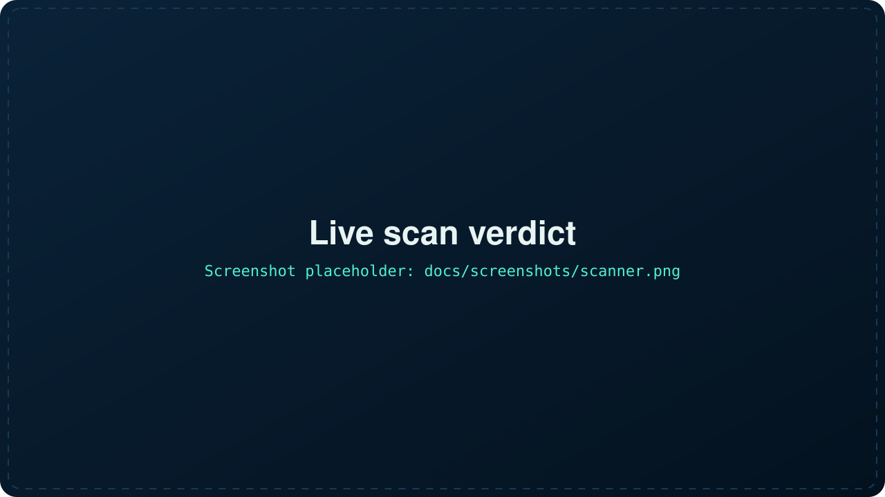
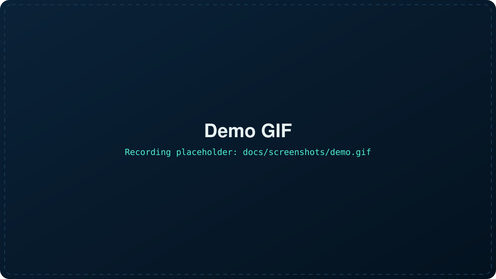
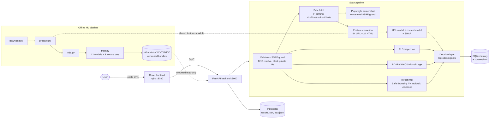
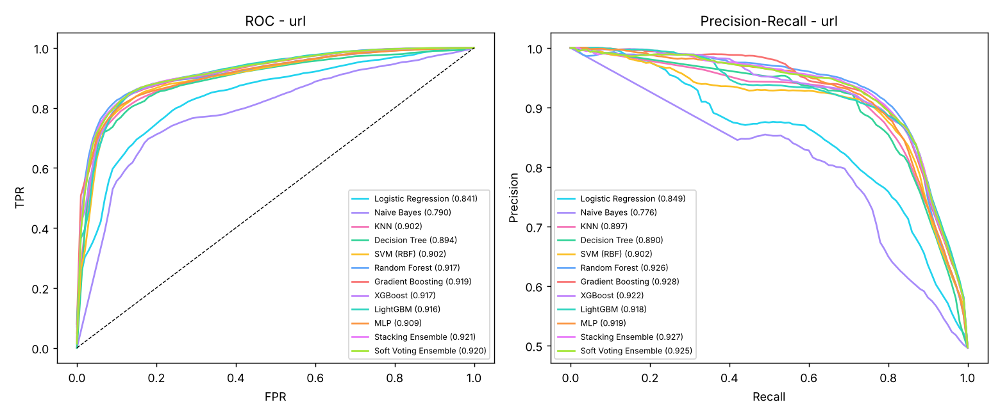
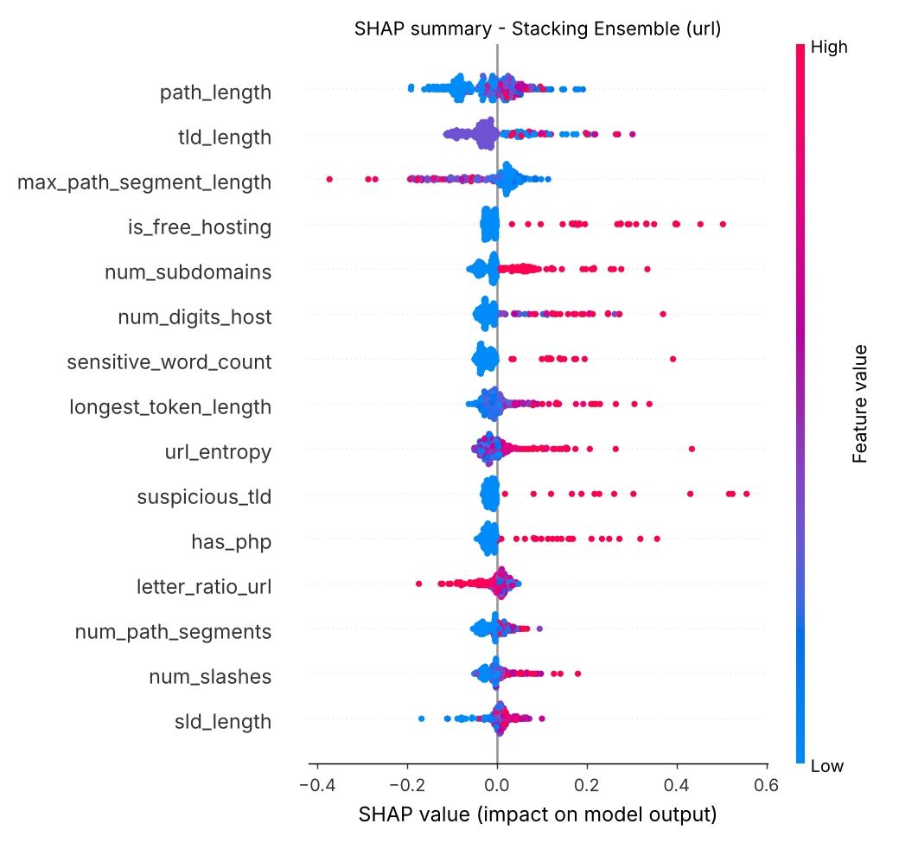
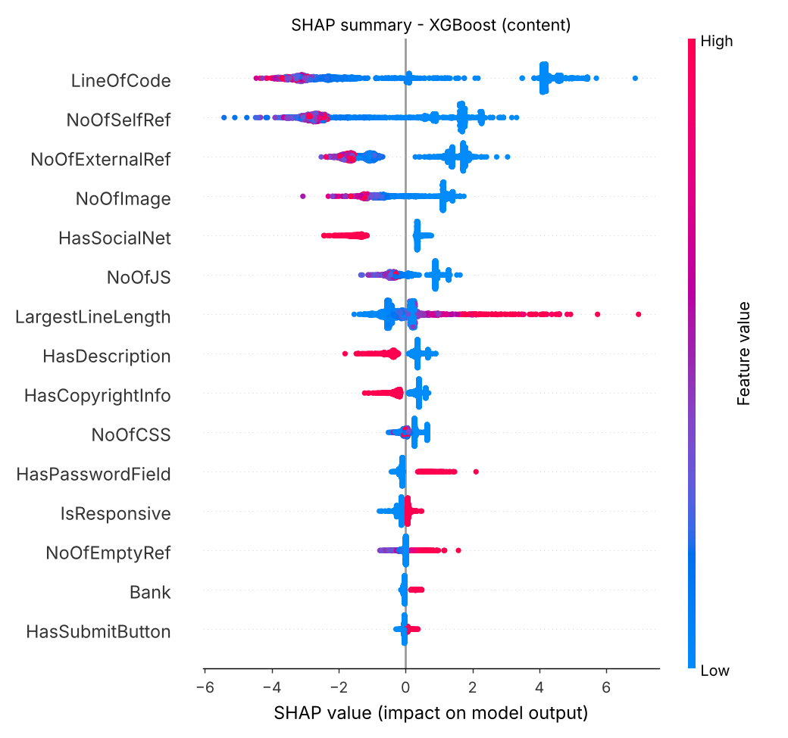

<p align="center">
  
</p>

<h1 align="center">PhishGuard</h1>
<p align="center"><b>A Comparative Machine Learning Framework for Robust Phishing Website Detection</b></p>
<p align="center">
  
  
  
  
  
</p>

> Paste any link. PhishGuard opens it in a sandboxed browser, extracts 68 features from the address and the page,
> runs the best of twelve compared models, weighs live evidence (domain age, TLS, redirects, reputation, threat
> intelligence) and returns **Legitimate / Suspicious / Phishing** with a probability, a screenshot and the reasons.

| Hero + scan bar | Live verdict | Model dashboard |
|---|---|---|
|  |  |  |



> **Screenshots are placeholders.** Replace the SVGs in `docs/screenshots/` with real captures (`hero.png`,
> `scanner.png`, `dashboard.png`, `demo.gif`) and update the links above.

---

## Table of contents
1. [Abstract](#abstract)
2. [Features](#features)
3. [Architecture](#architecture)
4. [Tech stack](#tech-stack)
5. [Datasets](#datasets)
6. [Methodology](#methodology)
7. [Results](#results)
8. [Robustness, leakage and explainability](#robustness-leakage-and-explainability)
9. [Quick start (Docker)](#quick-start-docker)
10. [Run locally without Docker](#run-locally-without-docker)
11. [Retraining the models](#retraining-the-models)
12. [API](#api)
13. [Environment variables](#environment-variables)
14. [Security model](#security-model)
15. [Project structure](#project-structure)
16. [Push to GitHub](#push-to-github)
17. [Limitations and ethics](#limitations-and-ethics)
18. [Future work](#future-work)
19. [References](#references)
20. [Credits and license](#credits-and-license)

---

## Abstract

Phishing detectors published on public benchmarks routinely report 97-100 % accuracy, yet many of them fail on real
links. This project asks *why*, and builds a detector that holds up outside the benchmark. Twelve classifiers
(Logistic Regression, Naive Bayes, KNN, Decision Tree, SVM, Random Forest, Gradient Boosting, XGBoost, LightGBM, an MLP,
and stacking / soft-voting ensembles) are tuned with Optuna and compared under identical conditions on three feature
sets: the classic **UCI Phishing Websites** benchmark, a **live URL-lexical** set and a **live HTML-content** set built
from **PhiUSIIL** and a second URL corpus.

The analysis uncovers strong dataset artefacts: every legitimate PhiUSIIL URL is a bare `https://www.<domain>`
homepage, one PhiUSIIL column (`URLSimilarityIndex`) separates the classes almost perfectly, and 47 % of UCI rows are
exact duplicates. Removing these shortcuts (URL canonicalisation, a second source of legitimate deep links,
reproducible-only features and **website-grouped** train/test splits) lowers the headline numbers but yields models
that generalise to unseen domains. The best models are served by a hardened FastAPI scanner that visits the URL
safely, explains each prediction with SHAP and fuses it with live evidence in a transparent decision layer.

## Features

- **12-model comparison** with identical splits, Optuna tuning, 5-fold cross-validation, and Accuracy / Precision /
  Recall / F1 / ROC-AUC / PR-AUC / confusion matrices / training and inference time for every model (JSON + CSV).
- **Leakage-aware ML**: URL canonicalisation, website-grouped splits, duplicate analysis, single-feature AUC audit,
  cross-dataset tests, ablations, calibration (Brier score), and a hand-picked real-world sanity suite.
- **Train/serve parity**: one feature-extraction module (`backend/app/features/`) is imported by both training and
  the live scanner; model bundles record the feature-schema version and a hash of the keyword lists.
- **Live scanner** (`POST /api/scan`): SSRF-guarded fetch with DNS pinning and per-redirect checks, Playwright
  screenshot in a sandboxed container, TLS certificate inspection, RDAP/WHOIS domain age, robots.txt, redirect chain,
  Google Safe Browsing, VirusTotal and urlscan.io (each optional), SHAP explanations, caching, rate limiting and
  SQLite history.
- **Cinematic frontend**: React + Vite + TypeScript, Tailwind, GSAP ScrollTrigger, Framer Motion, Lenis smooth scroll
  and a Three.js sonar globe; original animated SVG mascots (Lumen the guardian and the Angler) that react to every
  verdict; custom cursor, magnetic buttons, scroll-pinned storytelling, horizontal-scroll showcase, marquee, page
  transitions, intro animation, light/dark theme, 404 page; respects `prefers-reduced-motion`.
- **Docker**: multi-stage, non-root images, Chromium baked into the backend image, healthchecks, read-only root
  filesystems, dropped capabilities, volumes for models/reports/history, plus a hot-reload dev stack.

## Architecture



## Tech stack

| Layer | Technology |
|---|---|
| ML | scikit-learn 1.5, XGBoost 2.1, LightGBM 4.5, Optuna 4.1, SHAP 0.48, pandas, matplotlib/seaborn |
| Backend | FastAPI, Uvicorn, httpx, BeautifulSoup + lxml, tldextract, cryptography, python-whois/RDAP, Playwright (Chromium), SQLite |
| Frontend | React 18, Vite 5, TypeScript, Tailwind CSS 3, GSAP + ScrollTrigger, Framer Motion, Lenis, Three.js + React Three Fiber |
| Ops | Docker multi-stage builds, nginx-unprivileged, docker compose (prod + dev), hadolint |

## Datasets

| Dataset | Rows | Used for | Source (fallback mirror) |
|---|---|---|---|
| UCI Phishing Websites (Mohammad, Thabtah & McCluskey) | 11,055 x 30 | Comparison benchmark only | [UCI #327](https://archive.ics.uci.edu/dataset/327/phishing+websites) ([mirror](https://github.com/Arkit003/NetworkSecurity)) |
| PhiUSIIL Phishing URL Dataset (Prasad & Chandra) | 235,795 x 54 | URLs for the live URL model; HTML columns for the content model | [UCI #967](https://archive.ics.uci.edu/dataset/967/phiusiil+phishing+url+dataset) ([mirror](https://github.com/elaaatif/DATA-MINING-PhiUSIIL-Phishing-URL)) |
| Malicious-URL corpus (faizann24) | 420,464 URLs | Legitimate deep links + phishing on compromised hosts | [GitHub](https://github.com/faizann24/Using-machine-learning-to-detect-malicious-URLs) |

`python ml/data/download.py` downloads all three, falls back to the mirrors when UCI is unreachable, verifies mirror
files by SHA-256 and writes `ml/data/raw/manifest.json`. Raw data is **not** committed to git.

**Why an extra model?** Several UCI features (`web_traffic`, `Page_Rank`, `Google_Index`, `Links_pointing_to_page`,
`Statistical_report`) depend on discontinued services (Alexa, PageRank) and cannot be recomputed for a new URL, so the
UCI model is trained for comparison only. The **live** models are trained on features we *can* compute from a real
URL: 44 lexical features recomputed from the dataset URLs by our own extractor, and 24 PhiUSIIL HTML features whose
definitions we re-implemented for live pages.

## Methodology

1. **Cleaning.** Labels unified to `1 = phishing`. URLs are deduplicated after canonicalisation and URLs with
   conflicting labels are dropped. Each URL source is class-balanced (50/50) so the source itself can't predict the label.
2. **Canonicalisation.** Lower-case, strip scheme, strip `www.`, drop fragments and trailing slashes. This removes the
   PhiUSIIL "bare https://www homepage = legitimate" shortcut and its all-lower-case artefact. HTTPS is judged live
   from the actual certificate instead.
3. **Reproducible features only.** `URLSimilarityIndex`, `TLDLegitimateProb`, `URLCharProb`, title-match scores and
   undocumented redirect counts are excluded (see the leakage audit below).
4. **Splits.** 80/20 stratified split. For the live sets the split is **grouped by registered domain**
   (`StratifiedGroupKFold`), so no website is in both train and test. UCI uses a stratified random split, as in the
   literature, plus a deduplicated variant.
5. **Tuning.** Optuna TPE with 3-fold (grouped) CV on a stratified sample and the same budget for every model; then
   5-fold CV of the tuned model on the training set. SVM and KNN are trained on capped samples because of their
   O(n²) cost, which is documented in `results.json`.
6. **Selection.** The deployed model is chosen by **cross-validated F1** (tie-break: CV ROC-AUC), **never** by the
   test set. The test set is used once, for reporting.
7. **Explainability.** SHAP (TreeExplainer for tree models, permutation explainer otherwise) on held-out data;
   impurity/gain or permutation importance.
8. **Versioning.** `ml/models/vYYYYMMDD-HHMMSS/{url,content,uci}_model.joblib` + `metadata.json` (library versions,
   SHA-256 of every file, feature-schema version, keyword-list hash) and `ml/models/latest.json`.

### EDA highlights

| Class balance | Leakage audit (PhiUSIIL single-feature ROC-AUC) |
|---|---|
|  |  |

More figures in [`ml/reports/figures/`](ml/reports/figures): correlation heatmaps (`corr_*.png`), feature
distributions (`dist_*.png`), ROC/PR curves (`roc_pr_*.png`), confusion matrices (`confusion_*.png`), metric bars
(`metrics_*.png`) and SHAP summaries (`shap_beeswarm_*.png`). The notebook
[`ml/notebooks/01_eda_and_model_comparison.ipynb`](ml/notebooks/01_eda_and_model_comparison.ipynb) walks through all of it.

## Results

<!-- RESULTS:START -->
All numbers are on the **held-out test set** (20 %), produced by `ml/train.py` on the full data. Rows are sorted by
test F1. The **deployed** model was selected by 5-fold cross-validated F1, so it is not always the top test-F1 row.
Model version `v20261023-144910`

#### Live URL model - 62,063 train / 17,937 test rows, 44 features, stratified group (registered domain) split

| Model | CV F1 (5-fold) | Accuracy | Precision | Recall | F1 | ROC-AUC | PR-AUC | Train (s) | Inference / 1k rows |
|---|---|---|---|---|---|---|---|---|---|
| Random Forest | 0.8428 ± 0.011 | 0.8580 | 0.8601 | 0.8523 | 0.8562 | 0.9171 | 0.9265 | 7.1 | 14.40 ms |
| Soft Voting Ensemble | 0.8471 ± 0.013 | 0.8569 | 0.8554 | 0.8561 | 0.8558 | 0.9202 | 0.9255 | 14.1 | 44.78 ms |
| **Stacking Ensemble** (deployed) | 0.8489 ± 0.012 | 0.8552 | 0.8481 | 0.8624 | 0.8552 | 0.9209 | 0.9265 | 65.8 | 52.36 ms |
| LightGBM | 0.8458 ± 0.013 | 0.8548 | 0.8539 | 0.8533 | 0.8536 | 0.9156 | 0.9182 | 3.1 | 25.20 ms |
| Gradient Boosting | 0.8425 ± 0.010 | 0.8551 | 0.8588 | 0.8471 | 0.8529 | 0.9194 | 0.9284 | 36.2 | 2.90 ms |
| XGBoost | 0.8440 ± 0.013 | 0.8534 | 0.8547 | 0.8488 | 0.8517 | 0.9166 | 0.9223 | 2.4 | 4.60 ms |
| SVM (RBF) | 0.8407 ± 0.027 | 0.8426 | 0.8352 | 0.8505 | 0.8428 | 0.9017 | 0.9022 | 53.9 | 425.85 ms |
| MLP | 0.8454 ± 0.003 | 0.8380 | 0.8285 | 0.8490 | 0.8387 | 0.9092 | 0.9188 | 32.4 | 4.30 ms |
| KNN | 0.8145 ± 0.016 | 0.8398 | 0.8758 | 0.7888 | 0.8300 | 0.9019 | 0.8969 | 0.1 | 1211.08 ms |
| Decision Tree | 0.8086 ± 0.016 | 0.8255 | 0.8213 | 0.8284 | 0.8248 | 0.8936 | 0.8897 | 0.8 | 176 µs |
| Logistic Regression | 0.7893 ± 0.018 | 0.7744 | 0.7759 | 0.7664 | 0.7711 | 0.8405 | 0.8492 | 1.8 | 3.23 ms |
| Naive Bayes | 0.5816 ± 0.038 | 0.7003 | 0.8524 | 0.4785 | 0.6130 | 0.7899 | 0.7758 | 0.2 | 1.99 ms |

#### Live page-content model - 48,232 train / 11,768 test rows, 24 features, stratified group (registered domain) split

| Model | CV F1 (5-fold) | Accuracy | Precision | Recall | F1 | ROC-AUC | PR-AUC | Train (s) | Inference / 1k rows |
|---|---|---|---|---|---|---|---|---|---|
| Gradient Boosting | 0.9929 ± 0.004 | 0.9961 | 0.9967 | 0.9953 | 0.9960 | 0.9999 | 0.9999 | 15.2 | 2.03 ms |
| **XGBoost** (deployed) | 0.9937 ± 0.004 | 0.9961 | 0.9972 | 0.9948 | 0.9960 | 0.9999 | 0.9999 | 1.1 | 3.44 ms |
| Stacking Ensemble | 0.9933 ± 0.004 | 0.9961 | 0.9979 | 0.9941 | 0.9960 | 0.9999 | 0.9999 | 33.4 | 36.33 ms |
| LightGBM | 0.9934 ± 0.004 | 0.9960 | 0.9976 | 0.9943 | 0.9959 | 0.9999 | 0.9999 | 2.5 | 21.59 ms |
| MLP | 0.9905 ± 0.006 | 0.9958 | 0.9951 | 0.9963 | 0.9957 | 0.9998 | 0.9998 | 30.8 | 3.82 ms |
| Soft Voting Ensemble | 0.9935 ± 0.004 | 0.9958 | 0.9974 | 0.9941 | 0.9957 | 0.9999 | 0.9999 | 6.1 | 28.81 ms |
| Random Forest | 0.9853 ± 0.010 | 0.9952 | 0.9977 | 0.9925 | 0.9951 | 0.9998 | 0.9998 | 3.0 | 7.27 ms |
| SVM (RBF) | 0.9917 ± 0.003 | 0.9947 | 0.9941 | 0.9951 | 0.9946 | 0.9998 | 0.9998 | 1.8 | 16.53 ms |
| Logistic Regression | 0.9915 ± 0.004 | 0.9939 | 0.9929 | 0.9946 | 0.9938 | 0.9997 | 0.9997 | 0.2 | 732 µs |
| KNN | 0.9879 ± 0.004 | 0.9919 | 0.9899 | 0.9936 | 0.9918 | 0.9993 | 0.9992 | 0.0 | 423.86 ms |
| Decision Tree | 0.9794 ± 0.010 | 0.9902 | 0.9911 | 0.9889 | 0.9900 | 0.9980 | 0.9972 | 0.1 | 113 µs |
| Naive Bayes | 0.9583 ± 0.009 | 0.9675 | 0.9930 | 0.9400 | 0.9658 | 0.9958 | 0.9952 | 0.0 | 648 µs |

#### UCI benchmark (comparison only) - 8,844 train / 2,211 test rows, 30 features, stratified random split

| Model | CV F1 (5-fold) | Accuracy | Precision | Recall | F1 | ROC-AUC | PR-AUC | Train (s) | Inference / 1k rows |
|---|---|---|---|---|---|---|---|---|---|
| Soft Voting Ensemble | 0.9645 ± 0.002 | 0.9778 | 0.9794 | 0.9704 | 0.9749 | 0.9977 | 0.9973 | 2.6 | 68.19 ms |
| Stacking Ensemble | 0.9659 ± 0.003 | 0.9774 | 0.9814 | 0.9674 | 0.9743 | 0.9977 | 0.9974 | 13.9 | 92.03 ms |
| **Random Forest** (deployed) | 0.9665 ± 0.002 | 0.9760 | 0.9803 | 0.9653 | 0.9728 | 0.9975 | 0.9971 | 0.8 | 34.84 ms |
| LightGBM | 0.9648 ± 0.002 | 0.9747 | 0.9773 | 0.9653 | 0.9712 | 0.9969 | 0.9967 | 1.0 | 20.59 ms |
| Gradient Boosting | 0.9630 ± 0.002 | 0.9747 | 0.9792 | 0.9633 | 0.9712 | 0.9970 | 0.9968 | 1.5 | 3.82 ms |
| XGBoost | 0.9635 ± 0.003 | 0.9742 | 0.9772 | 0.9643 | 0.9707 | 0.9967 | 0.9965 | 0.9 | 19.14 ms |
| KNN | 0.9560 ± 0.003 | 0.9720 | 0.9781 | 0.9582 | 0.9680 | 0.9941 | 0.9929 | 0.0 | 119.92 ms |
| MLP | 0.9566 ± 0.002 | 0.9710 | 0.9731 | 0.9612 | 0.9671 | 0.9955 | 0.9952 | 6.2 | 2.87 ms |
| SVM (RBF) | 0.9563 ± 0.004 | 0.9692 | 0.9691 | 0.9612 | 0.9652 | 0.9930 | 0.9915 | 6.1 | 150.82 ms |
| Decision Tree | 0.9262 ± 0.006 | 0.9421 | 0.9286 | 0.9418 | 0.9352 | 0.9869 | 0.9830 | 0.0 | 222 µs |
| Logistic Regression | 0.9177 ± 0.005 | 0.9276 | 0.9343 | 0.9000 | 0.9168 | 0.9785 | 0.9766 | 0.0 | 437 µs |
| Naive Bayes | 0.8445 ± 0.004 | 0.8417 | 0.7476 | 0.9704 | 0.8446 | 0.9677 | 0.9617 | 0.0 | 730 µs |


**Reading the numbers.** The live URL model's ~86% F1 / 0.9209 ROC-AUC is measured
on **websites never seen in training**; it is the honest figure for a pasted link. The content model's near-perfect
scores and UCI's ~97% F1 are inflated by dataset artefacts (see below), which is the main
finding of the comparison.

| ROC / PR (live URL) | Confusion matrices (live URL) |
|---|---|
|  |  |

<!-- RESULTS:END -->

## Robustness, leakage and explainability

<!-- ROBUSTNESS:START -->
| Set | Check | Result | Note |
|---|---|---|---|
| Live URL | Random split vs **website-grouped** split | F1 87.9% vs **85.5%** | Same-site pages leaking across a random split inflate scores. |
| Live URL | Cross-dataset: train phiusiil, test url_paths | ROC-AUC 0.4726 | A model trained on one URL source does not transfer to the other, which is why both sources are combined. |
| Live URL | Cross-dataset: train url_paths, test phiusiil | ROC-AUC 0.8026 | A model trained on one URL source does not transfer to the other, which is why both sources are combined. |
| Live URL | Per-source test (phiusiil) | F1 87.6%, ROC-AUC 0.9163 | |
| Live URL | Per-source test (url_paths) | F1 83.6%, ROC-AUC 0.9253 | |
| Live URL | Hand-picked real-world URLs (24) | 96% correct | Illustrative only, never used for training or selection. |
| Live content | Without page-size features (LineOfCode, LargestLineLength, NoOfImage, ...) | F1 96.2% (vs 99.6%) | Size counts carry much of PhiUSIIL's signal. |
| Live content | Strongest single feature | LineOfCode: ROC-AUC 0.9905 | One column almost separates the classes, a dataset artefact. |
| UCI | Test rows that also occur in train | 1428 (65%) | 5,206 exact duplicate rows in the dataset. |
| UCI | F1 on unseen test rows only / deduplicated benchmark | 97.1% / 94.4% | Duplicates inflate the classic benchmark. |
| Live URL | Calibration (Brier score, deployed model) | 0.1132 | Lower is better; 0.25 = coin flip. |
| Live content | Calibration (Brier score, deployed model) | 0.0031 | Lower is better; 0.25 = coin flip. |
| UCI | Calibration (Brier score, deployed model) | 0.0195 | Lower is better; 0.25 = coin flip. |

**Explainability.** The most influential features (mean |SHAP|) of the deployed URL model (Stacking Ensemble) are
`path_length`, `tld_length`, `max_path_segment_length`, `is_free_hosting`, `num_subdomains`, `num_digits_host`; for the content model (XGBoost) they are `LineOfCode`, `NoOfSelfRef`, `NoOfExternalRef`, `NoOfImage`, `HasSocialNet`, `NoOfJS`.
The live API returns per-scan SHAP contributions, and the UI shows them as diverging bars.

| SHAP - live URL model | SHAP - live content model |
|---|---|
|  |  |

<!-- ROBUSTNESS:END -->

### How a live verdict is formed

```
p_ml   = 0.6 * p_url + 0.4 * p_content        (p_url only if the page can't be downloaded)
logit  = log(p_ml / (1 - p_ml)) + sum(signal adjustments)
p      = sigmoid(logit)  ->  < 0.40 Legitimate | 0.40-0.75 Suspicious | >= 0.75 Phishing
```

| Signal | Adjustment (log-odds) |
|---|---|
| Registered domain on reputation list (and not free hosting) | -2.5 |
| Domain age < 30 days / < 180 days / >= 5 years | +1.5 / +0.6 / -0.8 |
| Invalid, expired or self-signed certificate / plain HTTP / valid certificate | +1.0 / +0.5 / -0.2 |
| Cross-domain redirect / meta-refresh | +0.5 / +0.3 |
| Password form posting to another domain / password form + brand outside its domain | +1.2 / +0.8 |
| VirusTotal >= 3 detections / 1-2 / 0 (known URL) | +3.0 / +1.2 / -0.3 |
| Google Safe Browsing match | forces **Phishing** |

Every applied adjustment is returned in `signals[]` and shown in the UI, so the final number is fully auditable. The
reputation list (`backend/app/data/reputable_domains.txt.gz`, ~132 k domains) is built by `ml/build_reputation.py`
from PhiUSIIL's legitimate domains, minus free-hosting/shortener domains and minus every domain that appears as
phishing in any dataset. It is **not** a model feature; using it as one would leak the label.

## Quick start (Docker)

Requirements: Docker Desktop (Windows/macOS) or Docker Engine + Compose v2.24+.

```powershell
# Windows PowerShell
cd $HOME\Desktop\phishing-detector
docker compose up --build
```

Open **http://localhost:8080**. API docs: **http://localhost:8080/api/docs**. Stop with `Ctrl+C`, or run
`docker compose down` (add `-v` to also delete scan history).

- Trained models in `ml/models/` and reports in `ml/reports/` are mounted read-only, so no training is needed to start.
- API keys are read from `backend/.env` (optional; see [Environment variables](#environment-variables)).
- Hot-reload development stack: `docker compose -f docker-compose.dev.yml up --build`, then open http://localhost:5173.
- Retrain inside Docker: `docker compose --profile train run --rm trainer`, then `docker compose restart backend`.

## Run locally without Docker

Requirements: Python 3.12 or 3.13, Node.js 20+.

```powershell
powershell -ExecutionPolicy Bypass -File scripts\setup.ps1     # venv, packages, Chromium, frontend deps, backend\.env
powershell -ExecutionPolicy Bypass -File scripts\run_dev.ps1   # backend :8000 + frontend :5173 in two windows
powershell -ExecutionPolicy Bypass -File scripts\test.ps1      # backend test-suite
```

macOS/Linux: `scripts/setup.sh`, `scripts/run_dev.sh`, `scripts/test.sh`.

## Retraining the models

```powershell
powershell -ExecutionPolicy Bypass -File scripts\train.ps1          # full run (about 1-1.5 h on a 2-core CPU, much faster on 8 cores)
powershell -ExecutionPolicy Bypass -File scripts\train.ps1 -Fast    # smoke run (~20 min)
powershell -ExecutionPolicy Bypass -File scripts\train.ps1 -Sets url  # one feature set only
```

The pipeline: `ml/data/download.py`, then `ml/prepare.py`, `ml/eda.py`, `ml/build_reputation.py` and `ml/train.py`.
Each run writes a new version folder; the backend loads whatever `ml/models/latest.json` points to on start-up.
Budget knobs (env vars): `PG_FAST`, `PG_URL_SAMPLE`, `PG_CONTENT_SAMPLE`, `PG_TUNE_SAMPLE`, `PG_TRIALS`,
`PG_TUNE_TIMEOUT`, `PG_CV_MAX`, `PG_SVM_MAX`, `PG_KNN_MAX`, `PG_JOBS`. `python ml/report_table.py` prints the results
tables used in this README.

## API

| Method | Path | Description |
|---|---|---|
| `POST` | `/api/scan` | Scan a URL. Body `{"url": "https://example.com", "use_cache": true}` |
| `GET` | `/api/models` | Full comparison results (`ml/reports/results.json`) |
| `GET` | `/api/eda` | EDA summary (`ml/reports/eda.json`) |
| `GET` | `/api/health` | Status, loaded model version, browser and intel availability |
| `GET` | `/api/history?limit=20` | Recent scans (SQLite) |
| `GET` | `/api/history/{id}` | Full stored scan result |
| `GET` | `/api/intel/urlscan/{uuid}` | Poll a queued urlscan.io result |
| `GET` | `/api/screenshots/{id}.jpg` | Screenshot captured during a scan |
| `GET` | `/api/figures/{name}.png` | Report figures |

Interactive OpenAPI docs: `/api/docs`.

```bash
curl -s -X POST http://localhost:8080/api/scan -H "Content-Type: application/json" \
     -d '{"url":"https://github.com/login"}'
```

Abridged response (values are illustrative):

```json
{
  "id": "e30e2a4e...", "url": "https://github.com/login", "final_url": "https://github.com/login",
  "verdict": "legitimate", "probability_phishing": 0.13, "risk_score": 13, "confidence": 0.87,
  "ml": {"p_url": 0.98, "p_content": 0.27, "blend": 0.69, "weights": {"url": 0.6, "content": 0.4}},
  "signals": [{"id": "reputation", "label": "Well-known domain", "impact": -2.5, "severity": "good", "source": "reputation"}],
  "explanations": {"url": [{"feature": "sensitive_word_count", "label": "Sensitive words (login, verify, account...)", "value": 1, "shap": 1.9}], "content": []},
  "redirect_chain": [{"url": "https://github.com/login", "status": 200, "ip": "140.82.114.4", "kind": "http"}],
  "tls": {"available": true, "verified": true, "issuer": "...", "days_remaining": 60},
  "whois": {"available": true, "age_days": 6600, "registrar": "MarkMonitor Inc."},
  "intel": {"google_safe_browsing": {"status": "ok", "flagged": false}, "virustotal": {"status": "ok", "malicious": 0, "engines": 94}, "urlscan": {"status": "pending", "uuid": "..."}},
  "screenshot_url": "/api/screenshots/e30e2a4e....jpg",
  "timings_ms": {"fetch": 421, "tls": 544, "whois": 435, "screenshot": 3300, "total": 5800}
}
```

Errors: `400 invalid_url` (bad scheme, private/reserved address, unresolvable host), `429 rate_limited`
(10 scans/min per client by default), `503 model_not_ready`.

## Environment variables

Copy `.env.example` to **`backend/.env`**. Every key is optional; a missing key shows *not configured* for that panel.

| Variable | Default | Purpose |
|---|---|---|
| `GOOGLE_SAFE_BROWSING_API_KEY` | - | Google Safe Browsing v4 lookup |
| `VIRUSTOTAL_API_KEY` | - | VirusTotal v3 URL report (unknown URLs are submitted) |
| `URLSCAN_API_KEY` | - | urlscan.io scan submission + result polling |
| `URLSCAN_VISIBILITY` | `unlisted` | `public`, `unlisted` or `private` |
| `RATE_LIMIT_PER_MINUTE` | `10` | Scans per client IP per minute |
| `CACHE_TTL_S` | `900` | Re-use a scan result for the same URL |
| `SCREENSHOT_ENABLED` | `true` | Disable Playwright screenshots |
| `TOTAL_SCAN_BUDGET_S` | `40` | Hard time budget for one scan |
| `MAX_RESPONSE_BYTES` | `3000000` | Download cap per page |
| `MAX_REDIRECTS` | `5` | Redirect hop limit |
| `MODELS_DIR` / `REPORTS_DIR` / `DATA_DIR` | repo paths | Set automatically in Docker |
| `CORS_ORIGINS` | localhost dev ports | Allowed browser origins |
| `TRUST_PROXY_HEADERS` | `false` | Trust `X-Real-IP` (enabled behind the bundled nginx) |

`backend/.env` is listed in `.gitignore`, and the push scripts refuse to commit any `.env` file.

## Security model

Scanning arbitrary URLs from a server is an SSRF risk, so every outbound request is constrained:

- **Scheme/port allow-list**: only `http`/`https` on ports 80, 443, 8080 and 8443. URLs with embedded credentials are rejected.
- **DNS + IP checks**: the hostname is resolved and **every** address must be public. Loopback, RFC 1918, link-local
  (cloud metadata `169.254.169.254`), CGNAT, multicast, reserved, IPv4-mapped IPv6 and similar ranges are blocked.
- **Re-checked on every hop**: redirects are followed manually (max 5) and each target is validated again, as is
  every sub-request the headless browser makes (Playwright route interception).
- **DNS pinning**: the HTTP connection is made to the IP that passed the check, with the original `Host` header and
  TLS SNI, which defeats DNS rebinding between check and connect.
- **Limits**: connect/read timeouts, 3 MB body cap (streamed), whole-scan time budget, per-client rate limiting, a
  16 KB request-body cap at nginx.
- **Nothing is executed or stored from the target**: non-HTML bodies are never read, downloads are cancelled in the
  browser, service workers and permissions are blocked, and each scan uses a fresh incognito context.
- **Container hardening**: non-root users, read-only root filesystems, `cap_drop: ALL`, `no-new-privileges`, memory
  and PID limits, and no host mounts except read-only models/reports. Chromium's own sandbox is off by default inside
  the container (the container is the sandbox); set `BROWSER_SANDBOX=true` if your kernel allows it.
- **Residual risk**: Chromium resolves DNS itself, so the browser path is protected by per-request checks but not by IP
  pinning. Deploy behind an egress firewall that blocks private ranges for defence in depth.

## Project structure

```
phishing-detector/
├── backend/
│   ├── app/
│   │   ├── features/          # shared URL + HTML feature extractors (train/serve parity)
│   │   ├── security/ssrf.py   # SSRF guard
│   │   ├── services/          # fetcher, browser, tls, whois, intel, model, decision, scanner
│   │   ├── data/              # reputable_domains.txt.gz
│   │   ├── db.py  config.py  main.py
│   ├── tests/                 # pytest: features, SSRF/fetcher, intel/decision, API
│   ├── requirements*.txt  .env.example
├── frontend/
│   ├── src/{components,sections,pages,lib,styles}
│   ├── public/data/results.json   # static snapshot used when the API is offline
├── ml/
│   ├── data/download.py  prepare.py  eda.py  train.py  models.py  build_reputation.py  report_table.py  config.py
│   ├── notebooks/01_eda_and_model_comparison.ipynb
│   ├── models/vYYYYMMDD-HHMMSS/   # versioned bundles + metadata.json, latest.json
│   └── reports/                   # results.json, results_*.csv, eda.json, figures/
├── docker/  backend.Dockerfile  frontend.Dockerfile  ml.Dockerfile  nginx.conf
├── scripts/ setup.*  train.*  run_dev.*  test.*  push_to_github.*
├── docker-compose.yml  docker-compose.dev.yml
├── .env.example  .gitignore  .dockerignore  LICENSE  README.md
```

## Push to GitHub

```powershell
powershell -ExecutionPolicy Bypass -File scripts\push_to_github.ps1            # public repo demonmj/phishing-detector
powershell -ExecutionPolicy Bypass -File scripts\push_to_github.ps1 -Private   # private repo
```

The script initialises git, enables **Git LFS** for `ml/models/**/*.joblib` when `git-lfs` is installed (otherwise
it commits them directly if each file is under 95 MB), refuses to commit `.env` files, commits, and pushes `main`. With
the GitHub CLI (`gh auth login`) it also creates the repository; without it, create an **empty** repository at
https://github.com/new first. Raw datasets are never committed; `scripts/train.*` re-downloads them.

## Limitations and ethics

- **Dataset bias.** Legitimate PhiUSIIL pages are popular-site homepages; the content model therefore associates
  "small page with few links" with phishing. Legitimate login pages can look suspicious to it, which is why the
  decision layer weighs reputation, domain age and TLS. The ablation table quantifies the effect.
- **URL-only fallback.** Phishing pages are often taken down within hours; when a page can't be fetched only the URL
  model is used, which is weaker (ROC-AUC 0.9209 on unseen domains).
- **Evasion.** Cloaking (serving benign content to scanners), compromised legitimate domains, brand-new kits and
  adversarially crafted URLs can evade any static model. Treat the verdict as strong evidence, not proof.
- **Concept drift.** Phishing tactics change; retrain periodically with fresh feeds (e.g. PhishTank, OpenPhish).
- **Privacy.** URLs sent to VirusTotal and urlscan.io are shared with those services (urlscan defaults to
  `unlisted`). Scan history is stored locally in SQLite. Only scan URLs you are allowed to analyse.
- **Not a security product.** This is an academic project; do not rely on it as your only protection.

## Future work

- Fresh, time-split evaluation on live feeds (PhishTank/OpenPhish) to measure drift.
- Visual similarity (screenshot embeddings) against brand login pages.
- Character-level CNN/transformer URL models, and HTML/DOM graph models.
- Adversarial robustness testing (homoglyphs, URL padding) and probability calibration per source.
- Browser extension client and email-link integration.

## References

1. R. M. Mohammad, F. Thabtah, L. McCluskey. *Phishing Websites Data Set*. UCI ML Repository, 2015. doi:10.24432/C51W2X
2. A. Prasad, S. Chandra. *PhiUSIIL: A diverse security profile empowered phishing URL detection framework based on similarity index and incremental learning*. Computers & Security 136, 2024. doi:10.1016/j.cose.2023.103545
3. F. Ahmad (faizann24). *Using machine learning to detect malicious URLs*. GitHub repository.
4. S. M. Lundberg, S.-I. Lee. *A Unified Approach to Interpreting Model Predictions*. NeurIPS 2017.
5. T. Akiba et al. *Optuna: A Next-generation Hyperparameter Optimization Framework*. KDD 2019.
6. G. Ke et al. *LightGBM: A Highly Efficient Gradient Boosting Decision Tree*. NeurIPS 2017.
7. T. Chen, C. Guestrin. *XGBoost: A Scalable Tree Boosting System*. KDD 2016.
8. OWASP. *Server-Side Request Forgery Prevention Cheat Sheet*.

## Credits and license

**Photography (Unsplash License)**, hot-linked from `images.unsplash.com` in the "How the data was handled" section:

- Underwater view with sunlight filtering through water by [Digital Reach](https://unsplash.com/@digitalreachmarketing) on [Unsplash](https://unsplash.com/photos/underwater-view-with-sunlight-filtering-through-water-ZwcCisqoAv4)
- A fishing hook hanging from the side of a boat by [Kaptured by Kasia](https://unsplash.com/@kasiade) on [Unsplash](https://unsplash.com/photos/a-fishing-hook-hanging-from-the-side-of-a-boat-Fl3Rf_t8dMs)
- Fly fishing lure in close-up by [Anne Nygård](https://unsplash.com/@polarmermaid) on [Unsplash](https://unsplash.com/photos/fly-fishing-lure-in-close-up-90EQvn4WPw8)

**Fonts**: Bricolage Grotesque, IBM Plex Sans and IBM Plex Mono (SIL Open Font License), self-hosted via Fontsource.
**Mascots, icons and illustrations** are original SVGs made for this project.
**Datasets**: see [Datasets](#datasets) (UCI and PhiUSIIL are CC BY 4.0).

Code released under the [MIT License](LICENSE).
